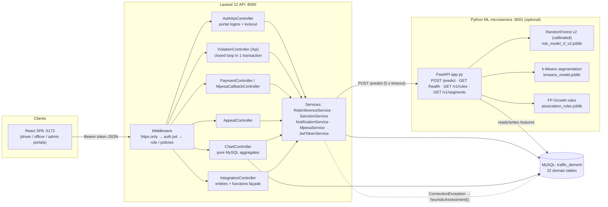
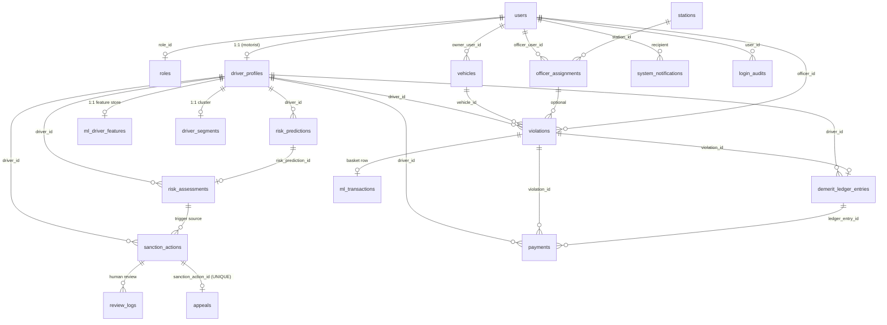
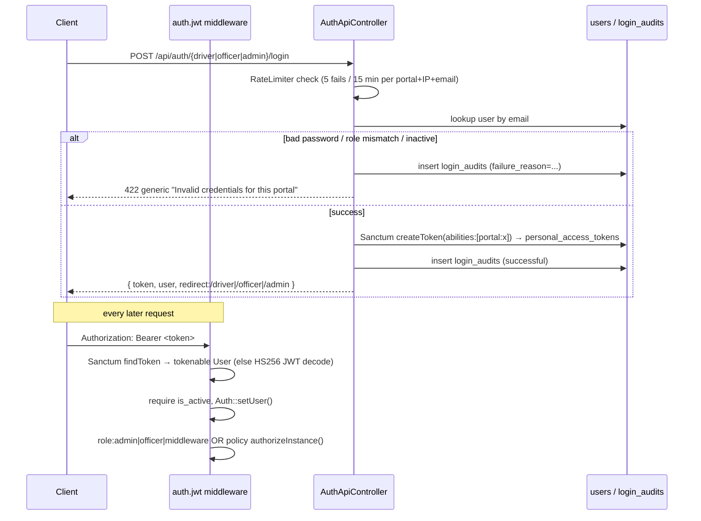
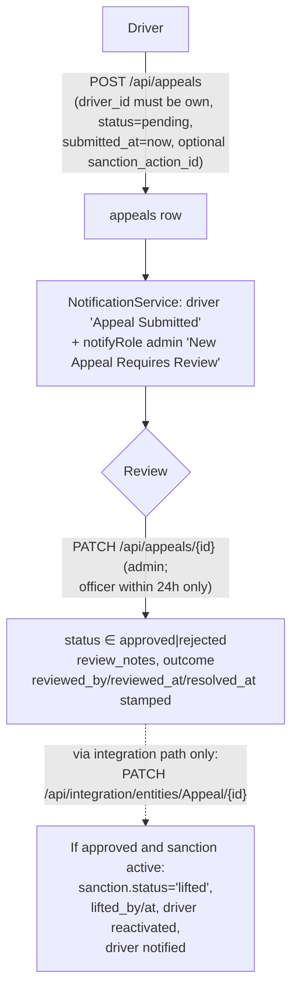

# ML Traffic Demerit System — Complete System Documentation

> **Scope and honesty note.** Every statement in this document is derived from reading the actual code in this repository (Laravel backend at `ML-Traffic-Demerit-System-main/apps/backend/traffic-demerit-web`, React frontend at `.../apps/frontend/traffic-demerit-portal`, Python ML microservice at `.../apps/backend/traffic-demerit-web/ml_service`). Where a feature is absent, ambiguous, or only partially implemented, this document says so explicitly rather than describing intent. Section 6 collects all such gaps into a risk register.

---

## 1. System Overview

**Plain language.** This is a national-scale traffic demerit platform for Kenya's NTSA. When a traffic officer catches a driver breaking the rule, they record the violation in the system. The system automatically assigns demerit points from a fixed table, appends them to a tamper-evident points ledger, scores how likely the driver is to reoffend (using a machine-learning model, with a rule-based fallback if the model is unavailable), and — if the risk score crosses configured thresholds — issues a graduated sanction (warning → mandatory training → account suspension). Drivers can pay fines and appeal sanctions; admins oversee everything. Every action is auditable.

### 1.1 Users and roles

The database has exactly three roles (`roles` table, seeded values `admin`/`officer`/`motorist`; `app/Models/User.php` exposes `isAdmin()`, `isOfficer()`, `isMotorist()`).

| Role (DB value) | Portal (URL segment) | What they do | Example account (seeder) |
|---|---|---|---|
| `admin` | `/admin` | Full CRUD on all entities, reviews appeals, lifts sanctions, views all analytics incl. ML insights | `admin@ntsa.go.ke` / `Admin@123` |
| `officer` | `/officer` | Records violations, views own statistics; can edit own violation within 24 h | `officer@ntsa.go.ke` / `Officer@123` |
| `motorist` | `/driver` | Self-registers, views own violations/ledger/risk, pays fines, files appeals | `driver@ntsa.go.ke` / `Driver@123` |

> The frontend "driver" portal maps to the backend role `motorist` (`AuthApiController::PORTAL_ROLES`, `app/Http/Controllers/AuthApiController.php`). The `/api/auth/me` transform renames it back to `driver` for the UI.

### 1.2 Technology stack

| Layer | Technology | Evidence |
|---|---|---|
| Backend framework | **Laravel 12** (`laravel/framework: ^12.0`) | `composer.json` |
| PHP version | **PHP ^8.2** | `composer.json` |
| Authentication | **Laravel Sanctum ^4** tokens (primary) + **firebase/php-jwt ^7.1** stateless HS256 JWT (legacy fallback) | `composer.json`, `AuthApiController::issueToken()`, `app/Services/JwtTokenService.php` |
| Database | **MySQL/MariaDB** (XAMPP in dev; migrations contain MySQL-only raw DDL, e.g. `2026_10_17_110004_add_voided_status_to_payments_table.php`) | `config/database.php`, migrations |
| Queue driver | **`sync`** — no queued jobs exist; `app/Jobs/` does not exist; no `ShouldQueue` anywhere | `.env`, `.env.example` |
| Scheduler | Laravel 12 closure schedule in `routes/console.php` — exactly **one** entry: `risk:batch-infer` hourly | `routes/console.php:60` |
| Mail | Synchronous `Mail::raw()` SMTP, wrapped by `app/Services/NotificationService.php` | `NotificationService::sendEmail()` |
| ML microservice | **Python FastAPI** on `127.0.0.1:8001` (`ml_service/app.py`); scikit-learn, pandas, joblib, mlxtend, SHAP | `ml_service/app.py`, `ml_service/requirements.txt` |
| Frontend | **React + Vite + Tailwind** SPA calling the API with Bearer tokens | `apps/frontend/traffic-demerit-portal/` |
| Payments | **M-Pesa Daraja** integration with a simulation mode (`MPESA_SIMULATE=true` by default) | `app/Services/MpesaService.php`, `config/mpesa.php` |

### 1.3 High-level architecture



**Key architectural fact:** the ML service is *optional by design*. If it is unreachable, `RiskInferenceService` catches the connection exception and computes a deterministic heuristic score (`model_version = heuristic_v1_ml_down`), so the violation → ledger → score → sanction closed loop keeps working (verified live: the demo environment has run for extended periods with `:8001` down).

---

## 2. Database Design

**Plain language.** The database has three layers: (1) **identity** (users, roles, stations, officer assignments, driver profiles, vehicles), (2) **enforcement** (violations, the append-only demerit ledger, payments, sanctions, appeals, review logs, notifications, login audits), and (3) **ML feature store** (pre-computed per-driver features, per-violation boolean baskets, trained segmentation/rule artifacts). A deliberate design rule runs through layer 2: **the ledger and sanctions are append-only** — corrections are new rows, never edits of old ones.

### 2.1 Table catalogue

*(`✓ deleted_at` = uses soft deletes via migration `2026_10_17_110003_add_soft_deletes_to_operational_tables.php`; `is_synthetic` boolean flag exists on 15 operational tables via `2026_10_17_000001` to mark seeder-generated demo rows.)*

| Table | Purpose | Key columns | Relationships |
|---|---|---|---|
| `users` | Login accounts for all roles (✓) | `email` UNIQUE, `password`, `role` enum(motorist,officer,admin), `role_id` FK, `is_active` | → `roles` (role_id SET NULL); 1→1 `driver_profiles`; 1→N `vehicles`, `officer_assignments`, `system_notifications`, `login_audits` |
| `roles` | Role lookup w/ permission level | `role_name` UNIQUE, `permission_level` (100/60/10) | 1→N `users` |
| `driver_profiles` | Demerit identity of a motorist (✓) | `license_no` UNIQUE, `full_name`, `license_issue_date` **NOT NULL no default**, `status`/`account_status` enum(active,restricted,suspended), `current_demerit_points` | → `users`; 1→N violations, ledger entries, risk assessments/predictions, sanctions, appeals |
| `vehicles` | Registered vehicles (✓) | `owner_user_id` FK CASCADE, `plate_number` UNIQUE, `make_model`, `vehicle_class` | → `users`; 1→N `violations` |
| `stations` | Police stations (✓) | `station_name`, `region`, `physical_address` | 1→N `officer_assignments` |
| `officer_assignments` | Officer ↔ station postings (✓) | `officer_user_id`, `station_id`, `badge_number`, `shift_type` enum(day,night,swing), `assignment_start_date` | → `users`, `stations`; 1→N `violations` |
| `violations` | Recorded offences (✓) | `driver_id` FK CASCADE, `vehicle_id`, `officer_id`, `offense_type`, `speed_recorded`, `posted_speed_limit`, `zone_type` enum(urban,highway,school_zone,residential), `weather_conditions` enum(clear,rain,fog,night), `points_assigned`, `status` enum(confirmed,disputed), `occurred_at` | → driver_profiles, vehicles, users, officer_assignments; 1→1 ledger entry(s), payment |
| `demerit_ledger_entries` | **Append-only** points ledger | `points_applied` (negative = reversal/decay), `running_balance` snapshot, `reason`, `reason_code` (`violation_auto_post`, `violation_edit_reversal`, `violation_edit_repost`, `violation_delete_reversal`), `days_since_last_offence` | → driver_profiles CASCADE, violations SET NULL |
| `risk_assessments` | One scored assessment per risk event | `risk_score` decimal(5,4), `risk_class` enum(low,moderate,high), `model_version`, `feature_snapshot` JSON (features, engine, SHAP top factors, latency), `generated_at` | → driver_profiles; ↔ `risk_predictions` |
| `risk_predictions` | Latest prediction per driver | `risk_score`, `risk_class`, `model_version`, `confidence_level`, `predicted_at` | → driver_profiles |
| `sanction_actions` | Automated/manual sanctions | `action_type` enum(warning,profile_restriction,profile_suspension), `sanction_type`, `trigger_reason`, `fine_amount`, `status` enum(active,lifted), `lifted_by/at`, `webhook_status` enum(pending,sent,failed), `webhook_response` | → driver_profiles, risk_assessments, risk_predictions; 1→N `review_logs`, appeals |
| `payments` | Fine payments (✓) | `violation_id` CASCADE, `driver_id`, `amount`, `amount_paid`, `method` enum(mpdoesa,card) + `payment_method`, `status` enum(pending,completed,failed,voided), `transaction_ref`, `checkout_request_id` UNIQUE, `mpesa_receipt`, `paid_at` | → violations, driver_profiles, demerit_ledger_entries |
| `appeals` | Driver appeals (✓) | `driver_id`, `violation_id`, `sanction_action_id` **UNIQUE** (max 1 appeal per sanction), `reason`, `status` enum(pending,approved,rejected), `outcome`, `reviewed_by` (string), `submitted_at`, `resolved_at` | → driver_profiles, violations, sanction_actions |
| `review_logs` | **Mandatory human review of ML-triggered sanctions** | `sanction_action_id` CASCADE, `reviewed_by_user_id`, `decision` enum(upheld,amended,reversed) **nullable = pending review**, `notes`, `reviewed_at` | → sanction_actions, users |
| `login_audits` | Every login attempt | `user_id`, `email`, `successful`, `failure_reason` (invalid_credentials / portal_role_mismatch / inactive_account / locked_out), `ip_address`, `user_agent`, `attempted_at` | → users |
| `system_notifications` | In-app + email-receipt messages | `recipient_user_id`/`recipient_role`, `channel` (in_app/email), `title`, `message`, `context` JSON, `status` enum(unread,read), `related_type/id` (manual polymorphic) | → users |
| `ml_driver_features` | **Feature store — one row per driver** (no Eloquent model; DB builder only) | `driver_profile_id` UNIQUE, `violation_count`, `cumulative_active_demerit_points`, `days_since_last_offense`, `avg_speed_over_limit`, `share_in_school_zone`, `share_at_night`, `total_fines_kes`, `past_fine_payment_delays_days`, `unpaid_fine_ratio`, `appeals_filed`, `reoffended_within_180_days` (label), `new_driver` | → driver_profiles |
| `ml_transactions` | **Basket encoding — one row per violation** for rule mining (no model) | 10 `type_*` booleans, 4 `zone_*`, 4 `weather_*`, `time_night/day`, `payment_late/completed/pending`, `appeal_filed`, `outcome_reoffended_180d` | → violations, driver_profiles |
| `segment_models` | Trained k-Means artifacts (no model) | `model_version` UNIQUE, `k`, `centroids` JSON, `scaler` JSON, `wcss`, `silhouette`, `wcss_by_k`, `silhouette_by_k`, `elbow_data`, `trained_at` | — |
| `driver_segments` | Cluster assignment per driver (no model) | `driver_profile_id` UNIQUE, `segment_id`, `segment_label`, `distance_to_centroid`, `pca_x/y`, `is_atypical` | → driver_profiles |
| `association_rules` | Mined FP-Growth rules (no model) | `antecedent`/`consequent` JSON, `support`, `confidence`, `coverage`, `lift`, `rule_family` enum(risk,context), `association_type`, `composite_score`, `plain_english`, `model_version` | — |
| Framework | `personal_access_tokens` (Sanctum), `sessions`, `cache`, `cache_locks`, `jobs`, `job_batches`, `failed_jobs`, `migrations` | standard Laravel | — |

**Notable absences:** there is **no `password_reset_tokens` table** and **no Laravel `notifications` table** (replaced by `system_notifications`); the standard Laravel migration was edited to remove them. `jobs`/`failed_jobs` exist but are never written by application code (queue is `sync`).

### 2.2 Entity-relationship diagram



---

## 3. Logical Flow of Operation

**Plain language.** The system's core loop is: *login → officer records violation → points posted to append-only ledger → risk scored → graduated sanction possibly triggered → driver pays/appeals → everyone notified and audited*. The sections below walk each step with the exact classes, tables and rules involved.

### 3.1 Authentication and role-based access



**Key mechanics** (`app/Http/Controllers/AuthApiController.php`, `app/Http/Middleware/AuthenticateJwt.php`, `app/Http/Middleware/EnsureUserHasRole.php`):

- **Portal-scoped logins.** `POST /api/auth/{portal}/login` with `whereIn('portal', ['driver','officer','admin'])`. Password, role-mismatch and inactive-account failures all return the **identical** message `"Invalid credentials for this portal"` so the endpoint can't be used to enumerate accounts.
- **Lockout.** `RateLimiter` keyed `login-lockout:{portal}:{ip}:{email}`; 5 failures → 15-minute lock (HTTP 429 with `retry_after`). Every attempt (success, failure, lockout) writes a `login_audits` row via `recordLoginAttempt()` — the single audit writer.
- **Tokens.** `issueToken()` prefers Sanctum (`createToken($portal, ['portal:…'])` → row in `personal_access_tokens`); on failure falls back to a stateless HS256 JWT from `app/Services/JwtTokenService.php` (TTL `auth.jwt_ttl_minutes`, default 30). `AuthenticateJwt` accepts **either**.
- **Authorization is layered:** route middleware `role:admin` etc. on charts/integration/portal routes; per-request `ResourceController::authorizeInstance()` → `Gate::authorize` when a policy exists, else a role fallback (admin → all; officer → read+create; else read); plus query-level motorist scoping (`scopeToMotorist()`), which limits rows to the caller's own `driver_profiles.user_id`.
- **Registration is driver-only.** `POST /api/auth/register` coerces `role='motorist'` and auto-creates a `DriverProfile` with `license_no = PENDING-{userId}` (must be fixed by an admin later).

### 3.2 Violation recording by an officer

Entry point: `Api\ViolationController::store()` (`POST /api/violations`) — **all steps below run inside one `DB::transaction`**.

1. **Validate** (`$storeRules`): `driver_id`, `vehicle_id`, `offence_type`, `speed_recorded`, `speed_limit`, `zone_type ∈ {urban,highway,school_zone,residential}`, `weather ∈ {clear,rain,fog,night}`, `location`, `evidence_reference`, `violation_date_time`, optional `officer_assignment_id`.
2. **Cross-checks:** the vehicle must belong to the driver (`vehicles.owner_user_id === driver_profiles.user_id`, else 422); the driver must not be locked (`status !== 'active'` → 422 "This driver profile is locked due to an active sanction.").
3. **Resolve officer**: `officer_assignment_id` → its `officer_user_id`, else the current user if an officer.
4. **Create** `violations` row, `status='confirmed'`, `occurred_at` from `violation_date_time`.
5. **Post to ledger** (see 3.3).
6. **Score risk** (see 3.4).
7. **Evaluate sanction** via `SanctionService::evaluate()` (see 3.5).
8. **Notify driver** via `NotificationService::notifyUser()` ("Violation Recorded … points applied … new balance … risk …").
9. Respond `201 {data, meta:{demerit_points, new_balance, risk:{score, classification, model_version}}}`.

> An **alternative write path** exists: `POST /api/integration/functions/processViolation` in `IntegrationController` (camelCase payload, same point map, same ledger/risk/sanction sequence) — but it sends **no driver notification**. The React app uses `/api/violations`.

**Edit and delete are append-only** (`Api\ViolationController::update()` / `destroy()`):

- **Edit**: find the latest positive ledger entry for the violation → append a **reversal** row (`points_applied = −oldPoints`, `reason_code='violation_edit_reversal'`) → apply field changes → append a **repost** row (`violation_edit_repost`, `+newPoints`). Balance is `running_balance` after repost.
- **Delete**: append a `violation_delete_reversal` row with `−points`, then **soft-delete** the violation. Ledger rows themselves are never mutated or deleted — the audit trail survives.
- Permission: officers may edit **their own** violation **within 24 h** (`ViolationPolicy` via `BasePolicy::withinWindow()`); deletion is **admin-only**.

### 3.3 Demerit point calculation and ledger

**Points come from a static lookup map, duplicated in three controllers** (`Api\ViolationController`, legacy `ViolationController`, `IntegrationController` — identical):

| Offence | Points | | Offence | Points |
|---|---|---|---|---|
| speeding | 4 | | phone_use | 3 |
| red_light | 5 | | illegal_parking | 2 |
| dui | 10 | | **unknown type** | **3 (default)** |
| reckless_driving | 8 | | no_seatbelt | 2 |

**There is no speed-over-limit multiplier and no zone multiplier in the points calculation** — speed/zone/weather influence only the risk score. (Seeder-only maps in `EnhancedDataSeeder` use different numbers — a documented inconsistency, see §6.)

Ledger posting (`DemeritLedgerEntry::create` inside the transaction):

```
newBalance   = driver->currentBalance()        // latest running_balance, else 0
newBalance  += points
entry        = { driver_id, violation_id, points_applied: points,
                 days_since_last_offence, running_balance: newBalance,
                 reason: 'violation', reason_code: 'violation_auto_post',
                 created_at/updated_at backdated to occurred_at }
driver->forceFill(['current_demerit_points' => newBalance, ...])->save()
```

`DriverProfile::currentBalance()` reads the **latest** ledger row's `running_balance` — the ledger is the source of truth; `current_demerit_points` is a denormalised cache.

### 3.4 Risk assessment and prediction generation

`RiskInferenceService::assessDriver($driver, $latestViolationContext)` — documented in full in **§4.1**. Summary: builds a 6-feature snapshot (deliberately **no demographics**), calls the Python `/predict` endpoint with a 5 s timeout, and persists both a `risk_assessments` row (with `feature_snapshot` JSON incl. SHAP top factors) and a `risk_predictions` row (score, class, confidence, `model_version`). On `ConnectionException` only, it falls back to the deterministic heuristic (`heuristic_v1_ml_down`). Called from `Api\ViolationController::store()`, the integration `processViolation` function, and the hourly `risk:batch-infer` scheduled command (all drivers, 50-row chunks).

### 3.5 Sanction triggers (graduated)

`SanctionService::evaluate($driver, $assessment)` (`app/Services/SanctionService.php`), thresholds from `config/risk.php` (env-overridable):

| Risk score | Action | `action_type` / `sanction_type` | Side effects |
|---|---|---|---|
| `< 0.40` | none | — | — |
| `0.40 – 0.5499` | **Warning** | `warning` / `warning` | `sanction_actions` row (webhook_status='sent'), in-app+email notification |
| `0.55 – 0.6999` | **Mandatory training** (restriction) | `profile_restriction` / `mandatory_training` | sanction row, `fine_amount = 0`, notification |
| `≥ 0.70` | **Suspension** | `profile_suspension` / `profile_suspension` | sanction row + **`review_logs` row with `decision = null`** (mandatory human review) + `driver_profiles.status = 'suspended'` (`applyLocalEffect`) + outbound webhook POST to `services.ntsa_webhook.url` (mock `http://127.0.0.1:8002/mock-ntsa-webhook`) + admin notifications on sync success/failure |

- Suspension is **idempotent**: skipped if the driver already has an active `profile_suspension`.
- A suspended driver **cannot receive new violations** (3.2 step 2 blocks the store with 422).
- Human review: `ReviewLog.decision` is `null` until an admin PATCHes it (`upheld`/`amended`/`reversed`) via `PATCH /api/integration/entities/ReviewLog/{id}`. `system:readiness-check` counts these as `pending_review_logs`.

> **Important legal/design note:** sanctions are triggered automatically by the score, but the suspension is *reviewable* — the human-review row is created **after** the suspension takes effect (post-hoc review, not pre-approval). See §6.

### 3.6 Payment handling

Three flows exist:

1. **Direct payment record** — `POST /api/payments` (`Api\PaymentController::store`): creates a `payments` row with `status='completed'` **immediately**, `amount_paid = amount`, auto-generated `reference_number = REF-{10 hex}` if absent, notifies the driver ("Payment Received"). Motorists can only pay their own violations. **Edit/delete are blocked with 405** — the only mutation is `POST /api/payments/{payment}/void` (sets `status='voided'`, `amount_paid=0`, notifies "Payment Voided").
2. **Mock M-Pesa checkout** — `POST /api/violations/{violation}/pay` (`PaymentController::initiate`): fine = `points_assigned × 500 KES` (`$finePerPoint = 500`), creates a **pending** payment with `transaction_ref = MOCK-…`; if `method='mpesa'` and `mpesa.simulate=false`, performs a real Daraja STK push and stores `merchant_request_id`/`checkout_request_id`. `POST /api/violations/{violation}/pay/mpesa` is the driver-facing variant (phone normalisation, ownership check). `POST /api/mpesa/callback` processes Daraja results: `ResultCode==0` → completed (+ duplicate-receipt guard returning 409) + violation confirmed + driver reactivated + notification; otherwise failed.
3. **Manual verification** — `POST /api/payments/{payment}/verify` (officer/admin/motorist): sets the final status, confirms the violation, and reactivates a suspended driver on completion.

### 3.7 Appeals and review process



- **Constraint:** `appeals.sanction_action_id` is **UNIQUE** → at most one appeal per sanction.
- **Gap (documented):** the apiResource path (`Api\AppealController::update`) stamps the review fields but does **not** lift the sanction, does **not** write a `review_logs` row, and does **not** notify the driver. Only the integration path (`IntegrationController::updateEntity` for `Appeal`) performs the full sanction-lifting cascade.

### 3.8 Notifications, audit logs, jobs

- **Notifications** — single mechanism: `app/Services/NotificationService.php` writing to `system_notifications`. `notifyUser()` inserts one `channel='in_app'` row and, if the user has an email, sends synchronous SMTP mail and records a **second `channel='email'` receipt row** (status `read` on success, `unread` with `context.email_error` on failure). This is why the UI shows two "duplicate" notifications per event — by design, not a bug. `notifyRole()` fans out one in-app row per recipient plus an email to every active user of that role.
- **Login audit** — `login_audits`, single writer `AuthApiController::recordLoginAttempt()` (see 3.1).
- **Review audit** — `review_logs`, written by `SanctionService::issueSuspension()` (pending row) and updated via the integration `ReviewLog` entity.
- **Jobs/queues — none.** No `app/Jobs` directory, no `ShouldQueue`, queue driver `sync`; mail and webhooks run inline in the request. The `jobs`/`failed_jobs` tables exist and are *read* by `system:readiness-check` (queue backlog, failure count) but never written by app code.
- **Scheduler** — exactly one entry: `Schedule::command('risk:batch-infer')->hourly();` (`routes/console.php:60`). Manual commands: `ml:train-all`, `ml:refresh-rules`, `ml:assign-segments`, `system:readiness-check`, `demo:verify*`, `demo:set-passwords`, `drivers:sync-pexels-photos`.

---

## 4. Machine Learning Components

**Plain language.** The "ML" in this system is four separate pieces: (1) a **supervised risk model** that estimates the probability a driver reoffends within 180 days; (2) a **k-Means segmentation** that groups drivers by behaviour (used for analytics, *not* for decisions); (3) **association-rule mining** that discovers interpretable patterns like "night + highway → reoffending" (also analytics-only at runtime); and (4) a **heuristic fallback scorer** that keeps the system running when the Python service is down. Sanctions are triggered by the risk score crossing fixed thresholds in `config/risk.php`.

### 4.1 Risk scoring (supervised) — the decision-driving model

| Aspect | Detail |
|---|---|
| **Purpose** | Predict probability a driver reoffends within 180 days; output drives automated sanctions. |
| **Code** | Trainer: `ml_service/train_supervised.py` (artefact `ml_service/model/risk_model_rf_v2.joblib`). Inference: `ml_service/app.py` (`POST /predict`, `/v1/predict`). PHP client: `app/Services/RiskInferenceService.php` (the **only** class that calls the service). |
| **Model type** | `Pipeline(ColumnTransformer → clf)` wrapped in `CalibratedClassifierCV(method='isotonic', cv=3)`. Candidates compared by ablation: `RandomForestClassifier(300 trees, depth 10, min_samples_leaf 3, class_weight='balanced')`, `GradientBoostingClassifier(200, depth 5)`, `LogisticRegression(2000 iterations, balanced)`. Best ROC-AUC wins; the artefact is versioned `"rf_v2"`. |
| **Input features (6, sent by PHP)** | `days_since_last_offense` (diff between last two violations, default 365), `speed_recorded`, `zone_type`, `weather_conditions` (from the triggering violation), `cumulative_active_demerit_points` (= `DriverProfile::currentBalance()`), `past_fine_payment_delays_days` (mean violation→paid days). Derived in `RiskInferenceService::buildFeatureSnapshot()` from `violations` + `demerit_ledger_entries` + `payments`. **Deliberately excludes gender/region/occupation** (also absent from the schema — see `driver_profiles` migration comment). The Python trainer additionally uses segment features and `rule_hit_count` (ablation sets B–D), but the PHP client does **not** send them — at inference the pipeline fills them with defaults. |
| **Output** | Calibrated probability `driver_risk_score` (isotonic), `risk_class` from cutoffs `LOW_CUTOFF=0.40` / `HIGH_CUTOFF=0.70` (`ml_service/app.py`), `confidence_level = max(p, 1−p)`, top-3 SHAP `TreeExplainer` factors, `inference_latency_ms`. Stored in `risk_assessments` (+ JSON `feature_snapshot`) and `risk_predictions` (score, class, confidence, `model_version`). |
| **Training/refresh** | **Manual only**: `php artisan ml:train-all` → shells out to `etl/build_features.py` → `segmentation/train_kmeans.py` → `rules/mine_rules.py` → `train_supervised.py` → `etl/eda.py` (`app/Console/Commands/TrainAll.php`, `proc_open`). **No scheduled retraining, no drift monitoring, no model registry** (grep for drift/PSI/KL: zero matches). Inference runs hourly via `risk:batch-infer`. |
| **Decision influence** | Feeds `SanctionService::evaluate()` (thresholds §3.5): ≥0.70 → automatic suspension + mandatory human `review_logs` row. Also exposed to admins via `IntegrationController::transformRisk` (`triggered_sanction` boolean). |
| **Evaluation metrics** | **Implemented in the trainer** (`train_supervised.py`): 5-fold stratified CV ablation reporting ROC-AUC, F1, precision, recall (means±std, `reports/ablation_report.json`); 80/20 hold-out ROC-AUC/F1; **fairness report** per group in `zone_type`, `weather_conditions`, `segment_id` — FPR/TPR, `fpr_ratio_to_overall`, flag when group FPR > 1.25× overall (`reports/fairness_report.json`). **No metrics are computed at runtime**; no drift/PSI metrics exist anywhere. |

**Worked example** (reproduced live from the demo environment, ML service *down*):

Driver Grace Wanjiru records speeding 112 km/h in an 80 zone, `urban`, balance 3 pts, no payment delays → heuristic formula (§4.5) gives `0.0135 + 0.124 + 0 + 0 + 0 = 0.1375` → `low` → **no sanction**. A later red-light offence lifts the balance to 6 with 4 days recency → `0.027 + 0.02 + 0 + 0.10 + 0 = 0.147` → still `low`. (Observed values in `risk_assessments`: 0.1375 and 0.147, `model_version=heuristic_v1_ml_down` — matches the formula exactly.)

With the ML service *up*, the same 6-feature vector would be the input to the calibrated RF pipeline, producing a probability instead — but note the trainer's target `reoffended_within_180_days` is currently almost entirely derived from **synthetic seed data** (see §6.1).

### 4.2 Supervised model v1 (legacy)

`ml_service/train_model.py` → `model/random_forest_pipeline.joblib` + `metadata.joblib` (`model_version='rf_v1'`). Plain `RandomForestClassifier(300, depth 10, min_leaf 3, balanced)` on the original 6 features, trained on `data/simulated_reoffending.csv` (2,500 rows generated by `generate_simulated_dataset.py` from a **documented logistic function**, seed 42). Metrics: 80/20 ROC-AUC, F1, full `classification_report` printed. `rf_v1` is also the **PHP-side default label** (`config('risk.php')::model_version`) and the seeder's label — meaning seeded rows claim `rf_v1` even though no runtime code loads that artefact.

### 4.3 Driver segmentation (k-Means, unsupervised)

| Aspect | Detail |
|---|---|
| **Purpose** | Cluster drivers by behaviour; flag atypical drivers; provide interpretable profiles for the ML-insights dashboard. |
| **Code** | `ml_service/segmentation/train_kmeans.py`; tables `segment_models`, `driver_segments`; PHP client `app/Services/SegmentationService.php`. |
| **Model** | `StandardScaler` → `KMeans(k, n_init=25, random_state=42)`; k chosen by WCSS elbow (`KneeLocator`, fallback 3) reconciled with max silhouette for |k−elbow|≤1; 2-component PCA **only for plotting**. |
| **Features (7, all from `ml_driver_features`)** | `violation_count`, `cumulative_active_demerit_points`, `avg_speed_over_limit`, `past_fine_payment_delays_days`, `unpaid_fine_ratio`, `days_since_last_offense`, `share_at_night`. Median imputation of NaNs. No demographics. |
| **Output** | Per driver: `driver_segments.segment_id` (0..k−1), rule-generated `segment_label` (e.g. "Habitual night-time speeders", "Chronic late payers", "Low-risk compliant"), `distance_to_centroid`, `pca_x/y`, `is_atypical` (distance > mean+2σ). Per model: `segment_models` row with centroids (JSON, original units), scaler, WCSS, **silhouette**, elbow/silhouette curves. |
| **Refresh** | Manual: `php artisan ml:assign-segments` (re-runs full training). No schedule. |
| **Decision influence** | **None at runtime.** No controller reads `driver_segments` for decisions; `SegmentationService` is never injected/called by any controller (verified by grep). Segments appear only in `ChartController::mlInsights` dashboards and in the trainer as optional features. |
| **Metrics** | Per-k WCSS + silhouette computed and persisted (`wcss_by_k`, `silhouette_by_k`, final `silhouette`); plots in `ml_service/reports/eda/`. No Davies-Bouldin/gap statistic. |

### 4.4 Association-rule mining (FP-Growth)

| Aspect | Detail |
|---|---|
| **Purpose** | Discover interpretable context→outcome rules ("night driving + speeding → reoffending within 180 d") for the ML-insights page. |
| **Code** | `ml_service/rules/mine_rules.py` (`mlxtend.frequent_patterns.fpgrowth`; Apriori imported but unused); table `association_rules`; PHP client `app/Services/RulesService.php` (**never called by controllers**). |
| **Input** | Boolean baskets from `ml_transactions` (one row per violation): 10 `type_*`, 4 `zone_*`, 4 `weather_*`, `time_night/day`, `payment_late/completed/pending`, `appeal_filed`, `outcome_reoffended_180d`. Basket built by `etl/build_features.py` (night = hour ≥18 or ≤6; `payment_late` = paid >30 days late; reoffended = next violation ≤180 d). |
| **Parameters & output** | `min_support = 0.05`, `min_confidence = 0.60`, antecedent length ≤3. Computes support, confidence, coverage, lift; `rule_family` (`risk` if consequent ∈ {reoffended_180d, payment_late} else `context`); `association_type` (lift >1.05 positive, <0.95 negative); `composite_score = (s·c·cov·l)^0.25` with normalisations; plus `plain_english` text. Stored in `association_rules` (`model_version='rules_v1'`). |
| **Refresh** | Manual: `php artisan ml:refresh-rules` (deletes old `rules_v1`, re-mines). No schedule. |
| **Decision influence** | **None directly.** Rules can become a training feature (`rule_hit_count`, ablation sets C/D) and the FastAPI `/v1/predict` returns `top_matching_rule` for display; no sanction logic reads rules. |
| **Metrics** | Self-test on a 14-transaction toy basket asserts Support 14.3% / Confidence 66.7% / Coverage 21.4% / Lift 1.556 (`test_lecture_example`). No precision@k / held-out evaluation. |

### 4.5 Heuristic fallback scorer (rule-based, production safety net)

`RiskInferenceService::heuristicAssessment()` — active whenever the ML service raises `ConnectionException` (timeout/unreachable). Exact formula from the code:

```php
$score  = min(0.45, $balance / 100 * 0.45);                 // demerit load (saturates at 45 pts)
$score += $speed > 0 ? min(0.20, ($speed - 50) / 100 * 0.20) : 0.0;
$score += $zone === 'school_zone' ? 0.10 : 0.0;
$score += $daysSince < 30 ? 0.10 : ($daysSince < 90 ? 0.05 : 0.0);
$score += min(0.15, $delay / 60 * 0.15);                     // payment delinquency
$score = round(min(0.99, max(0.0, $score)), 4);
```

Class from the same `config/risk.php` cutoffs (≥0.70 high, ≥0.40 moderate). `model_version = 'heuristic_v1_ml_down'`, `confidence_level = 0.55` hard-coded, `engine = 'HeuristicFallback (ML service unreachable)'`. "SHAP" factors are synthetic splits of the final score (points × 0.5, days × 0.3, delay × 0.2).

> **Observed quirk (verified in code, line 125):** for `0 < speed < 50` the second term is **negative** and *subtracts* from the score — e.g. speed 20 gives `−0.06`. Harmless in practice (recorded speeds below 50 rarely occur with this term) but it is a genuine formula defect.

### 4.6 Feature engineering (ETL)

`ml_service/etl/build_features.py` — the deterministic feature store builder invoked by `ml:train-all`:

- Extracts `violations`, `demerit_ledger_entries`, `payments`, `driver_profiles`, `sanction_actions`, `appeals`.
- **Per driver → `ml_driver_features`**: `violation_count`; `cumulative_active_demerit_points` = latest ledger `running_balance`; `days_since_last_offense` (default 365); `new_driver = violation_count < 2`; `avg_speed_over_limit` = mean of `max(0, recorded − limit)` over speeding violations; `share_in_school_zone`; `share_at_night` (share of violations with `weather_conditions='night'` — i.e. *night is encoded as a weather value*, a schema quirk); `total_fines_kes`; `past_fine_payment_delays_days`; `unpaid_fine_ratio = 1 − paid/Σ OFFENSE_FINES` clipped [0,1]; `appeals_filed`; label `reoffended_within_180_days` (2nd violation within 180 d of the first).
- **Per violation → `ml_transactions`** boolean basket (see 4.4).
- Static maps `OFFENSE_POINTS` and `OFFENSE_FINES` defined here are used **only for feature/fine estimation** — production point assignment uses the controller map (§3.3).

### 4.7 FastAPI microservice surface

`ml_service/app.py` (v2.0.0, models loaded at startup):

| Endpoint | Behaviour |
|---|---|
| `GET /health`, `GET /v1/health` | status + `models_loaded{risk_model,kmeans,rules}` booleans |
| `POST /predict` (legacy, used by PHP) | 6-feature payload → calibrated probability, class, SHAP top-3, latency |
| `POST /v1/predict` | same + `top_matching_rule`; segment fields always null |
| `POST /v1/segment` | 7 features → `cluster_id`, `distance_to_centroid` (query params — the PHP `SegmentationService` posts JSON, an **untested mismatch**) |
| `GET /v1/segments`, `GET /v1/rules`, `GET /v1/model-info` | read endpoints over `segment_models`/`driver_segments`/`association_rules` via pymysql |

Cutoffs configurable via `RISK_LOW_CUTOFF` / `RISK_HIGH_CUTOFF` env. Missing model → 503 (PHP treats 503 as an error, **not** a fallback — only connection failures trigger the heuristic).

---

## 5. Strengths

Evidence-based, each tied to code:

1. **Resilient by design (graceful ML degradation).** `RiskInferenceService` catches `ConnectionException` and falls back to a deterministic scorer with a distinct `model_version`, so the entire enforcement loop survives an ML outage — verified live for extended periods with `:8001` down (`app/Services/RiskInferenceService.php:41-47,115-170`).
2. **Append-only, auditable ledger.** Edits and deletions never mutate history — they append reversal/repost rows with `reason_code`s (`violation_edit_reversal`, `violation_edit_repost`, `violation_delete_reversal`); deletions soft-delete only the violation (`Api\ViolationController::update/destroy`). This yields a tamper-evident points history.
3. **Atomic enforcement transactions.** Violation → ledger → balance → risk → sanction → notification all run inside a single `DB::transaction` (`Api\ViolationController::store`), preventing partial states (e.g. points without a ledger row).
4. **Layered authorization.** Route middleware (`role:…`) + 9 Eloquent policies (`app/Policies/`) + `BasePolicy` with a **24-hour officer edit window** + query-level motorist scoping (`scopeToMotorist`) — three independent enforcement layers.
5. **Anti-enumeration login + lockout + audit.** Identical generic error for bad password/role mismatch/inactive (`AuthApiController::portalLogin`), 5-fail/15-min `RateLimiter` lockout, and a `login_audits` row for *every* attempt including lockouts.
6. **Human review is mandatory for the harshest sanction.** `issueSuspension()` always creates a `review_logs` row with `decision=null`; `system:readiness-check` surfaces `pending_review_logs`; only admins can decide `upheld/amended/reversed`.
7. **Privacy-minimal feature design.** Gender/region/occupation are deliberately absent from `driver_profiles` (migration comment cites algorithmic-bias ethics); the feature snapshot explicitly excludes demographics; the trainer ships a **group fairness report** (FPR ratios per zone/weather/segment with a 1.25× flag) — unusual for a student-scale project.
8. **Explainability.** Real model: top-3 SHAP `TreeExplainer` factors stored in `risk_assessments.feature_snapshot`; rules: `plain_english` column; even the heuristic returns labelled pseudo-factors so the UI always has an explanation object.
9. **Payment integrity.** Duplicate M-Pesa receipt guard (409 + `failed` mark) in both `MpesaCallbackController` and `PaymentController::completePayment`; payments are immutable (405 on edit/delete) with an explicit **void** path; `checkout_request_id` UNIQUE.
10. **Chart endpoints are pure MySQL aggregates** (`ChartController`) — dashboards keep working with the ML service down; `SystemStatusController` reports DB counts + ML probe independently.
11. **Comprehensive test suite for a project this size** — 43 tests / 250 assertions (backend), including portal auth, integration hardening, and payment verification contracts; plus a Playwright UI-vs-DB proof harness (`docs/proof/proof.mjs`, 40/40 checks).
12. **Self-documenting ML artefacts.** `segment_models` stores centroids, scaler, WCSS/silhouette curves; `association_rules` stores support/confidence/lift/composite/plain-English; `model-info` endpoint declares provenance ("synthetic training data + real database features").

---

## 6. Weaknesses and Risks

### 6.1 ML weaknesses

1. **The supervised target is trained mostly on synthetic data.** `ml_driver_features.reoffended_within_180_days` is derived from seeded `violations` generated by `DemoDataSeeder` (random dates, 20% "chronic" flag, forced highway-night speeding correlation). The model therefore learns *the seeder's randomness*, not real recidivism. **Fix:** collect real enforcement data before trusting scores; mark synthetic-trained artefacts clearly in production dashboards.
2. **`rf_v1` label mismatch.** Seeders stamp `model_version='rf_v1'` on assessments/predictions they generate, and `config/risk.php` defaults to `rf_v1`, yet the only production trainer produces `rf_v2` and the PHP client never loads a version from config for inference. **Fix:** propagate the actual served model version from `/v1/model-info` into persisted rows.
3. **Feature mismatch at inference.** The trained v2 pipeline can use segment features + `rule_hit_count` (ablation sets B–D), but `RiskInferenceService` sends only the legacy 6 features — unseen columns silently default to 0 inside the pipeline. If the champion model was trained with set C/D, live scores are computed on a different feature space. **Fix:** send the full feature vector or retrain with set A only.
4. **No retraining pipeline, no drift monitoring.** `ml:train-all` is manual; the only scheduled job re-infers. No PSI/KL/concept-drift checks exist (grep verified). **Fix:** scheduled retraining + drift report + champion/challenger.
5. **Heuristic formula defect.** `($speed − 50)` goes negative for speeds below 50 (§4.5), and the heuristic's "SHAP" factors are fabricated splits, not real attributions — potentially misleading in an appeal. **Fix:** clamp at 0; label factors as "estimated shares".
6. **No runtime evaluation.** No ground truth (did the driver actually reoffend?) is ever fed back into `ml_driver_features` automatically — the label column exists but nothing updates it post-hoc. Metrics in `train_supervised.py` are offline-only.
7. **Segmentation and rules are dead weight at runtime.** `SegmentationService` and `RulesService` are never called by controllers; `/v1/segment` has a query-param/JSON-body mismatch with its PHP client; the FastAPI `/v1/predict` never returns a segment label (always null). The ML-insights dashboard reads tables directly, so users see segments the decision engine ignores — an expectation gap.
8. **Night is encoded in `weather_conditions`.** The enum conflates weather with time-of-day (`night`), and `share_at_night` is computed from it — a data-model smell that pollutes both features and fairness groups.
9. **Evaluation metrics exist only offline** — no shadow scoring, no calibration monitoring, no precision@k for the high-risk band that actually triggers suspensions.

### 6.2 Technical weaknesses

1. **`sync` queue + inline SMTP/webhook.** Every notification sends synchronous mail and every suspension fires an outbound HTTP webhook (`Http::timeout(5)`) inside the request. Slow SMTP or the mock webhook (8002, usually down) directly slows violation recording. **Fix:** switch `QUEUE_CONNECTION=database` and queue mail/webhooks.
2. **Point map duplicated in 3 controllers** (`Api\ViolationController`, legacy `ViolationController`, `IntegrationController`) plus 2 different seeder maps (`EnhancedDataSeeder` uses speeding 5 / red_light 4 / dui 8 — inconsistent with runtime). Drift risk. **Fix:** single `OffenseCatalog` service/config.
3. **Two divergent write paths.** `POST /api/violations` sends driver notifications; integration `processViolation` does not. Appeals via apiResource don't lift sanctions; integration `Appeal` update does. Behaviour depends on which door you use. **Fix:** route both through one domain service.
4. **Dead/misleading code.** `App\Http\Controllers\ViolationController` is imported in `routes/api.php` but never routed; `App\Mail\SystemEventMail` is unreferenced; `driver.scope` middleware is registered but never applied; `POST /api/mpesa/callback` sits behind `auth.jwt` despite a "Public (no auth)" docblock — a **real Daraja callback would 401**.
5. **Seeder bugs.** `DemoDataSeeder` writes invalid `shift_type` values (weather strings) into `officer_assignments.shift_type` enum; `EnhancedDataSeeder`'s `createNotifications()`/`createLoginAudits()` are commented out and reference non-existent columns; `login_audits.is_synthetic` is in `LoginAudit::$fillable` but **no migration creates that column** (would break any insert setting it).
6. **Mass-assignment gap.** `Payment::$fillable` omits the five M-Pesa columns (`merchant_request_id`, `checkout_request_id`, `mpesa_receipt`, `result_code`, `result_desc`) — the callback path must use `forceFill`, inviting silent bugs.
7. **`payments.status()` ownership check compares `user()->id` to `payment->driver_id`** (`PaymentController::status`) — user id ≠ driver_profile id, so this check is wrong (drivers effectively can't poll their own payment status reliably).
8. **Missing indexes/relationships for scale.** No FK index on `violations.officer_id`; `ChartController::admin()` uses correlated `MAX(id)` subqueries for the latest prediction per driver (O(drivers) scans); no `belongsToMany` anywhere means fan-out joins are done in PHP. 1,500 violations are fine; 10 M would not be.
9. **No form requests, no custom exception handler.** All validation is inline (`$storeRules` arrays), error shapes rely on Laravel defaults; there is no central place to evolve the API error contract.
10. **Test coverage is behavioural, not statistical.** 43 tests cover HTTP contracts; nothing asserts model quality, calibration, or fairness at deploy time.

### 6.3 Security and privacy

1. **Personal data.** `driver_profiles` holds licence numbers, full names, and now `profile_photo_path` (via `drivers:sync-pexels-photos`, which downloads stock portraits — a privacy-neutral but odd choice for real licences). No encryption-at-rest for PII; API responses expose emails to admins/officers by design.
2. **CORS is wide open** (`config/cors.php`: all origins/methods/headers, `supports_credentials=false`). With Bearer tokens in `localStorage` (`traffic_demerit_portal_token_v1`), any origin can call the API if it obtains a token; XSS exfiltration is the bigger risk. **Fix:** restrict `allowed_origins` to the portal origin.
3. **Tokens in localStorage + 30-min JWT fallback** with `app.key` as HS256 secret; Sanctum tokens have no explicit expiry set at creation (`expires_at` nullable). **Fix:** set token expiry; consider httpOnly cookies for the SPA.
4. **M-Pesa callback authentication is broken** (behind `auth.jwt` — external Daraja cannot authenticate). In `simulate` mode this is moot; in production the callback is either unreachable or must be opened up without additional signing verification. **Fix:** verify Daraja signature/ip allowlist, remove `auth.jwt` from the route.
5. **`https.only` is a no-op in `local` env** — and `.env` ships `APP_ENV=local`, so HTTPS enforcement is effectively off in this deployment.
6. **Audit-trail completeness:** logins and ML-triggered sanctions are audited; **violations, payments and appeals are not** (no generic activity log; `review_logs` covers only sanctions). An admin editing a violation leaves no "who changed what" trace beyond `updated_at`.
7. **Automated sanctions act *before* human review** — suspension + status lock + outbound webhook fire immediately at ≥0.70; the `review_logs` row is created afterwards. The driver is locked out until an admin reviews (there is an appeal path, and lifting reactivates the driver, but the *initial* effect is automated). This is the key legal/ethical exposure — see recommendations.

### 6.4 Legal and ethical concerns (automated sanctions)

- **Human-in-the-loop exists but is post-hoc.** `issueSuspension()` = automated effect + mandatory review row. For fairness and due-process (Kenya's Data Protection Act 2019 and general principles of administrative action), the harsher sanction should ideally be **stayed pending review** or appealable within a defined SLA.
- **Explainability is provided** (SHAP factors, plain-English rules) — good — but the heuristic fallback's factors are synthetic approximations, which could mislead an appeal board.
- **Bias surface is limited but real:** no demographic features (good), yet `zone_type` and `weather/night` correlate with geography and socio-economic patterns; the fairness report checks FPR parity per zone/night groups — but nothing *acts* on the flags.
- **No model card / DPIA** documents accompany the artefacts; provenance notes exist only in `/v1/model-info`.

---

## 7. Recommendations and Future Improvements

### High priority

1. **Fix the M-Pesa callback route** (remove `auth.jwt`, add signature verification) before any production use — currently a real callback cannot succeed.
2. **Add a pre-effect review gate for suspensions** (e.g. `status='pending_suspension'` until a human decides), or at minimum an SLA + appeal shortcut that restores driving pending review. Aligns the system with due-process expectations.
3. **Queue mail and webhooks** (`QUEUE_CONNECTION=database`, `ShouldQueue` notifications); move `dispatchWebhook` out of the request cycle.
4. **Unify the write paths** — one `ViolationService`/`AppealService` used by both apiResource and integration routes, so notifications and sanction-lifting behave identically everywhere.
5. **Fix correctness bugs**: `payments.status()` ownership comparison; heuristic negative-speed term; `Payment::$fillable` M-Pesa columns; seeder `shift_type` values; `login_audits.is_synthetic` column (drop from fillable or add migration).
6. **Train on real data / label provenance** — either retrain `rf_v2` once genuine violations accumulate, or visibly mark scores derived from synthetic-trained models in the UI.

### Medium priority

7. **Single offence catalog** (config or service) consumed by controllers, ETL and seeders; delete the legacy `ViolationController` and `SystemEventMail`.
8. **Deploy segmentation/rules consistently** — either wire `SegmentationService`/`RulesService` into dashboards or remove the dead clients; fix the `/v1/segment` query-param/JSON mismatch.
9. **Add drift + retraining automation**: scheduled monthly `ml:train-all`, PSI monitoring per feature, and a champion/challenger report in `ml-insights`.
10. **Index and query hardening**: FK indexes on `violations.officer_id`, replace the correlated-latest-prediction subquery with a window function (MySQL 8) or materialised "latest" table.
11. **CORS + token hygiene**: restrict origins, set Sanctum token expiry, prefer httpOnly storage.
12. **Generic activity audit log** for mutations (who changed which violation/payment/appeal, old→new values).

### Low priority

13. Form Request classes + a central API exception handler for a stable, versioned error contract.
14. Remove `night` from `weather_conditions`; add a proper `time_of_day` column and re-derive features.
15. Model card + DPIA documentation; surface fairness flags in the admin UI (currently computed but not acted upon).
16. SQLite-portability cleanups (raw MySQL DDL migrations guard partially; `110004` is unguarded).

---

## 8. Appendix

### 8.1 Glossary

| Term | Meaning |
|---|---|
| **Demerit points** | Points assigned per offence from a static map (speeding 4, red-light 5, DUI 10, reckless 8, phone 3, seatbelt/parking 2, default 3). Accumulating them raises risk and can trigger sanctions. |
| **Ledger (`demerit_ledger_entries`)** | Append-only journal of point movements; each row snapshots `running_balance`. Corrections are negative/positive reversal rows, never edits. |
| **Risk score** | Calibrated probability (0–1) that the driver reoffends within 180 days; from the RF model or the heuristic fallback. |
| **Risk class** | `low` (<0.40), `moderate` (0.40–0.6999), `high` (≥0.70) — cutoffs in `config/risk.php`. |
| **Segment** | k-Means cluster of drivers with a human label (e.g. "Habitual night-time speeders"); analytics only, not used for decisions. |
| **Association rule** | FP-Growth pattern (antecedent → consequent) with support/confidence/lift and a plain-English rendering. |
| **Sanction** | Automated action on `sanction_actions`: warning (≥0.40), mandatory training/restriction (≥0.55), suspension (≥0.70). |
| **Review log** | Mandatory human-review record for an ML-triggered suspension; `decision` null until an admin decides upheld/amended/reversed. |
| **`is_synthetic`** | Boolean flag marking seeder-generated demo rows (15 operational tables). |
| **Heuristic fallback** | Deterministic PHP scorer used when the ML service is unreachable; `model_version='heuristic_v1_ml_down'`. |
| **Portal** | Login segment `driver|officer|admin` mapping to role `motorist|officer|admin`. |

### 8.2 Running, seeding and testing

```powershell
# 1. Database (XAMPP MySQL on 3306, database: traffic_demerit, root, no password)
C:\xampp\mysql\bin\mysql.exe -u root -e "CREATE DATABASE IF NOT EXISTS traffic_demerit"

# 2. Backend (Laravel 12, port 8000)
cd ML-Traffic-Demerit-System-main\apps\backend\traffic-demerit-web
composer install
copy .env.example .env        # DB_* already point at XAMPP; ML_SERVICE_URL=http://127.0.0.1:8001
php artisan key:generate
php artisan migrate           # then: php artisan db:seed  (DemoDataSeeder)
C:\xampp\php\php.exe artisan serve --host=127.0.0.1 --port=8000

# 3. Frontend (Vite, port 5173)
cd ..\..\frontend\traffic-demerit-portal
npm install
npm run dev

# 4. ML microservice (optional — system runs without it via heuristic)
cd ..\..\backend\traffic-demerit-web\ml_service
"C:\Program Files\Python312\python.exe" -m uvicorn app:app --host 127.0.0.1 --port 8001

# 5. Train the full ML stack (manual; writes features, segments, rules, rf_v2 model)
php artisan ml:train-all          # or individually: ml:assign-segments · ml:refresh-rules

# 6. Tests
php artisan test                  # 43 tests / 250 assertions (uses traffic_demerit_test DB)
# UI-vs-DB proof harness (Playwright): node docs/proof/proof.mjs   → 40/40 checks
```

Demo logins: `admin@ntsa.go.ke`/`Admin@123` · `officer@ntsa.go.ke`/`Officer@123` · `driver@ntsa.go.ke`/`Driver@123` · example driver `grace@example.com`/`Driver@123`.

### 8.3 Key files

| File (relative to `apps/backend/traffic-demerit-web`) | One-line description |
|---|---|
| `routes/api.php` | All 61 API routes with middleware stacks (auth, charts, CRUD, integration, portal, M-Pesa). |
| `routes/console.php` | The single scheduled job (`risk:batch-infer` hourly) + closure commands (`system:readiness-check`, photo sync). |
| `app/Http/Controllers/AuthApiController.php` | Portal-scoped logins, 5-fail/15-min lockout, driver-only registration, `login_audits` writer. |
| `app/Http/Controllers/Api/ViolationController.php` | The enforcement closed loop: validate → violation → ledger → risk → sanction → notify; append-only edit/delete. |
| `app/Http/Controllers/Api/ResourceController.php` | Generic CRUD engine: policy `authorizeInstance`, motorist scoping, filter/sort/pagination (per_page ≤100). |
| `app/Http/Controllers/Api/PaymentController.php` | Create/void payments only (405 on edit/delete); auto `REF-` references. |
| `app/Http/Controllers/PaymentController.php` | Mock/real M-Pesa checkout: initiate, payMpesa, status, manual verify, duplicate-receipt guard. |
| `app/Http/Controllers/MpesaCallbackController.php` | Daraja callback handler (⚠ currently behind `auth.jwt`). |
| `app/Http/Controllers/Api/AppealController.php` | Driver appeals + admin/officer review (stamps only; no sanction lift). |
| `app/Http/Controllers/Api/ChartController.php` | Pure-MySQL chart aggregates for admin/driver/officer/ML-insights dashboards. |
| `app/Http/Controllers/IntegrationController.php` | 15-entity CRUD façade + 4 server functions (processViolation, predictAccidentRisk, compliance & readiness reports). |
| `app/Http/Controllers/SystemStatusController.php` | Footer status: DB counts + ML `/health` probe (2 s). |
| `app/Services/RiskInferenceService.php` | The only Python-ML client; feature snapshot; heuristic fallback (`heuristic_v1_ml_down`). |
| `app/Services/SanctionService.php` | Graduated sanctions (0.40/0.55/0.70), mandatory `review_logs`, driver lock, NTSA webhook. |
| `app/Services/NotificationService.php` | `system_notifications` in-app rows + synchronous email with 'email receipt' row. |
| `app/Services/MpesaService.php` | Daraja STK push/query with full simulation mode. |
| `app/Services/JwtTokenService.php` | Legacy HS256 JWT issue/decode (fallback to Sanctum). |
| `app/Policies/BasePolicy.php` (+8 policies) | Role/ownership/24-h-window authorization rules. |
| `app/Models/DriverProfile.php` | Core aggregate: `currentBalance()` from latest ledger row. |
| `app/Models/DemeritLedgerEntry.php` | Append-only ledger row model. |
| `database/seeders/DemoDataSeeder.php` | Generates ~400 drivers, ~1,500 violations, payments, risk rows, sanctions, appeals (all `is_synthetic=1`). |
| `ml_service/app.py` | FastAPI inference service: `/predict`, `/v1/predict`, `/v1/segment`, `/v1/rules`, `/health`. |
| `ml_service/train_supervised.py` | RF v2 trainer: ablation CV, calibration, fairness report, `risk_model_rf_v2.joblib`. |
| `ml_service/train_model.py` | Legacy v1 trainer on synthetic CSV (`random_forest_pipeline.joblib`, `rf_v1`). |
| `ml_service/etl/build_features.py` | Feature store builder → `ml_driver_features` + `ml_transactions`. |
| `ml_service/segmentation/train_kmeans.py` | k-Means + elbow/silhouette + PCA → `segment_models`/`driver_segments`. |
| `ml_service/rules/mine_rules.py` | FP-Growth mining → `association_rules` with composite score + plain English. |
| `ml_service/generate_simulated_dataset.py` | Synthetic 2,500-row reoffending dataset (documented logistic, seed 42). |
| `config/risk.php` | The sanction thresholds (0.40 / 0.55 / 0.70) and classification bounds. |
| `docs/proof/proof.mjs` | Playwright UI-vs-SQL end-to-end proof harness (40/40 checks). |

---

*Document generated from code inspection on 2026-10-18. Backend verified: Laravel 12, 43 tests / 250 assertions green; ML service verified down with heuristic fallback active (`risk_assessments.model_version = heuristic_v1_ml_down`).*
